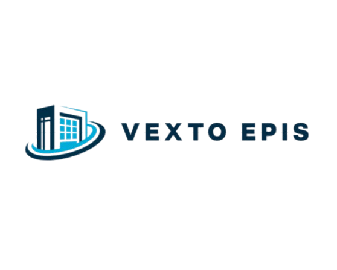

  <!-- Substitua o link abaixo pelo caminho da logo de vocês. Ex: ./assets/logo.png -->
  
  
  <h1>Vexto EPI's - Vending Machine 🛠️🥽</h1>
  <h3>Desenvolvido por: Equipe Vexto EPI</h3>

 

##  Integrantes e Funções

Nossa equipe **Vexto EPI** é formada por:

*   **Alvaro:** Back-End & Full Stack
*   **Jasmine:** Banco de Dados & Analista
*   **Flávia:** Front-End & Design
*   **Emanuelli:** Front-End & Design

---

## Descrição do Projeto
A **Vexto EPI's** é uma solução inteligente em formato de *Vending Machine* desenvolvida para a gestão e distribuição de Equipamentos de Proteção Individual (EPIs) em empresas, indústrias e instituições de ensino técnico (como o SENAI). O projeto tem como foco agilizar e facilitar a retirada diária de equipamentos, evitando deslocamentos desnecessários até almoxarifados centrais e garantindo um sistema organizado e seguro.

O sistema conta com uma arquitetura baseada em IoT, processamento de imagens e gerenciamento de estoque em tempo real.

## Objetivo
Facilitar o acesso aos EPIs utilizados diariamente (como luvas, máscaras, óculos e protetores auriculares), mantendo um sistema prático e rastreável. A máquina permite o acesso rápido via interface intuitiva e identificação, economizando tempo operacional e fornecendo aos gestores um controle preciso do estoque e histórico de retiradas através de um Dashboard dedicado.

## Persona
**Ana, 23 anos:** Trabalha em um departamento de química e entra/sai de laboratórios todos os dias. Durante o expediente, ela utiliza diversos tipos de EPIs. Porém, toda vez que precisa de uma luva ou touca nova, ela precisa sair da área técnica, retirar o jaleco e ir até o almoxarifado central, perdendo cerca de 15 minutos de produtividade. A máquina da Vexto EPI's resolve exatamente esse gargalo.

## Requisitos do Sistema

### Requisitos Funcionais
- [x] Interface gráfica (Tablet) para a escolha dos EPIs pelo usuário.
- [x] Liberação dos EPIs mediante identificação (nome completo, escaneamento de crachá da empresa ou reconhecimento facial).
- [x] Estrutura fechada com compartimento seguro ("abertura") para a retirada do produto.
- [x] Dashboard gerencial com o histórico de retiradas (qual EPI, quem retirou e o horário).
- [x] Controle de situação do estoque dentro da máquina.

### Requisitos Não-Funcionais
- [x] Acessibilidade e usabilidade: a máquina e a interface devem ser fáceis de utilizar por todos os funcionários.
- [x] Processamento rápido da escolha e dispensação do EPI.
- [x] Capacidade física adequada para armazenar quantidades razoáveis de EPIs específicos do local.

## 🛠️ Tecnologias e Componentes Físicos

**Software & Arquitetura:**
- **Back-end:** Python 3.12 (Processamento, API e controle de hardware).
- **Front-end:** Aplicação Web/React (hospedada em um repositório secundário) + Landing Page de apresentação.
- **Banco de Dados:** Armazenamento do estoque, perfil de usuários e logs de retirada.

**Hardware & Eletrônica:**
- **Microcontroladores:** ESP32.
- **Motores:** 3 Motores de Passo (NEMA 17) para a dispensação.
- **Drivers:** 3 Drivers A4988.
- **Alimentação:** 1 Fonte Chaveada AC/DC 110/220V para 12V (aprox. 5A).
- **Estrutura Física:** Montagem em perfis de alumínio (colunas/base), placas de acrílico desenhadas e cortadas sob medida, e peças impressas em 3D.
- **Mecanismo:** Sistema de rosca sem fim (semelhante às máquinas de salgadinhos) para queda controlada do equipamento.

## Como Executar o Projeto

1. **Pré-requisitos do Ambiente:**
   - Ter o **Python 3.12** instalado na máquina.
   - Configurar o Banco de Dados com as seguintes credenciais obrigatórias para o funcionamento:
     - **Usuário:** `vendingMachine`
     - **Senha:** `123456`

2. **Instalação e Execução via `.bat`:**
   - O projeto conta com um script de automação. Na raiz do repositório, baixe o arquivo zip e execute o arquivo executável `.bat`.
   - **O que ele faz?** Ele automaticamente faz o download/atualização das novas mudanças do repositório, instala todas as bibliotecas necessárias para o Python e roda a aplicação localmente.

## Documentação e Links do Projeto

*   **Repositório Back-end Principal:** [Acessar GitHub](https://github.com/AlvaroANetto/VendingMachine)
*   **Planilha de Horários:** [Acessar Planilha](https://docs.google.com/spreadsheets/d/1gym4NLa96sAwihr2PyEZ0My6c4sp_wIlvi9zlQyorvI/edit?usp=sharing)
*   **Histórico de Sprints (Kanban):** [Acessar Sprints](https://docs.google.com/document/d/1r8bNzeANFXBZWiFE8Es-8MMRaFy1rL3dGxqvrFLySLE/edit?usp=sharing)
*   **Apresentação do Projeto:** [Acessar Apresentação no Canva](https://canva.link/2x89k4jcep4gnu5)
*   **Roteiros e Documentação:** [Acessar Documento](https://docs.google.com/document/d/1ZHl_yuspQVoM2-Kjh01sNACVQwc9-rzo5oPT9Uc6skw/edit?usp=sharing)

   
  

 Landing Page: O acesso rápido também pode ser feito escaneando o Qr Code a baixo.
     
  
  
  <h1>Vexto EPI's - Vending Machine 🛠️🥽</h1>
  <h3>Desenvolvido por: Equipe Vexto EPI</h3>

 
   

---
*Projeto desenvolvido como Trabalho de Conclusão de Curso (TCC) do curso técnico de Desenvolvimento de Sistemas do SENAI.*
